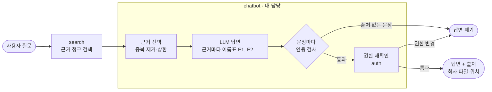
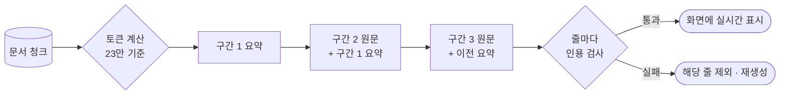

# 현답 · 근거 기반 AI 답변·요약 — 소용우

> 현대 부트캠프 AI서비스개발과정 3팀 프로젝트 **현답**에서 제가 맡은 `chatbot` 파트를 정리한 포트폴리오입니다.
> 팀 전체 소개는 원본 레포 [paul8004-lee/Hyundap](https://github.com/paul8004-lee/Hyundap)에 있습니다.

**LLM이 지어낸 답을 사용자 화면에 내보내지 않는 것**을 목표로, 회사 문서 근거로만 답하고 모든 문장에 출처를 다는 답변·요약·문서 분류 기능을 만들었습니다.

 

## 한눈에 보기

| 항목 | 내용 |
|---|---|
| 프로젝트 | 다중 기업 문서 검색 플랫폼 — 회사별 문서를 올리고, 검색하고, AI에게 질문·요약을 요청 |
| 기간 | 2026.10.08 ~ 2026.11 |
| 팀 | 7명, 폴더 단위 담당제 (PR 리뷰 승인 후 병합) |
| 내 역할 | [`hyundap/chatbot/`](hyundap/chatbot) 전담 — 근거 기반 답변, 긴 문서 요약·스트리밍, 업로드 문서 자동 분류 |
| 기술 | Python 3.11 · OpenAI API (gpt-5, gpt-6-luna, Decisions API) · LangChain · tiktoken · unittest |
| 기여 | PR 9개 (병합 6 · 검토 중 1) · 코드 약 1,300줄 · 테스트 55개 |

 

## 내 파트가 하는 일

검색(search)이 찾아 준 문서 조각만 근거로 LLM에게 답하게 하고, 답변을 화면에 보내기 전에 **인용 검사**와 **권한 재확인**을 거칩니다.

| 기능 | 함수 | 설명 |
|---|---|---|
| 질문 답변 | `ask()` | 근거 검색 → 답변 생성 → 인용 검사 → 권한 재확인 → 답변·출처 반환 |
| 문서 요약 | `summarize_document()` · `summarize_document_stream()` | 긴 문서를 토큰 기준으로 나눠 직렬 요약, 검증된 줄만 실시간 전송 |
| 문서 분류 | `classify_common_document()` · `decide_doc_type()` | 업로드 문서의 유형과 회사 일치 여부를 자동 분류 |
| 오류 안내 | `to_feedback()` | 내부 오류를 숨기고 화면용 안내 문구로 변환 |

 

## 핵심 1. 근거 기반 답변 — 지어낸 답은 화면에 나가지 않게

**문제**
사내 문서 Q&A에서 LLM이 문서에 없는 내용을 그럴듯하게 지어내면 그대로 오답이 됩니다. 또 답변을 만드는 사이에 사용자의 문서 접근 권한이 바뀔 수도 있습니다.

**해결**
- 근거 조각마다 `[E1]`, `[E2]` 이름표를 붙여 보내고, **모든 문장 끝에 이름표**를 달도록 했습니다.
- 이름표가 없는 문장이 있거나, 준 적 없는 이름표를 쓰면 **답변 전체를 버립니다.** (제목 줄·"확인할 수 없습니다" 같은 유보 문장은 예외)
- 근거가 하나도 없으면 LLM을 부르지 않고 "제공된 문서에서 확인할 수 없습니다"로 답합니다.
- 답변을 돌려주기 직전에 인용한 문서·버전을 지금도 볼 수 있는지 auth에 **다시 확인**하고, 실패하면 만든 답변을 버립니다.

**트러블슈팅**

| 문제 | 원인 | 해결 |
|---|---|---|
| "선택 문서"로 범위를 좁히면 답이 문서 안에 있어도 "확인할 수 없습니다" ([#194](https://github.com/paul8004-lee/Hyundap/pull/194)) | 문서당 근거 4개 상한이 항상 적용돼, 한 문서만 대상일 때 8개 중 4개만 사용 → 정답 섹션이 잘림 | 문서당 상한 = `max(4, 8 ÷ 근거에 나온 문서 수)`. 함수 인자를 바꾸지 않아 명세·다른 파트 수정 없이 해결 |
| `**회사명**`, `### 회사명` 같은 제목 줄 때문에 정상 답변이 통째로 거부됨 ([#194](https://github.com/paul8004-lee/Hyundap/pull/194)) | 인용 검사가 콜론으로 끝나는 제목만 허용 | 마크다운 제목 형식을 허용하되, `**…입니다**`처럼 강조로 감싼 무인용 문장은 계속 차단 |
| 점수 낮은 다른 문서 하나가 섞이면 주 문서의 근거가 잘림 ([#276](https://github.com/paul8004-lee/Hyundap/pull/276), 검토 중) | 문서가 2개로 판정돼 문서당 상한이 4개로 줄어듦 | 상한 적용 후 남은 자리를 잘린 근거로 점수순 채움 |

 

## 핵심 2. 긴 문서 요약 + 실시간 스트리밍 ([#214](https://github.com/paul8004-lee/Hyundap/pull/214))

**문제**
기존 요약은 8청크씩 부분 요약한 뒤 다시 병합하는 방식이라 문서 하나에 LLM을 **최대 9번** 순서대로 불렀고, 64청크 상한 때문에 큰 문서는 뒤쪽이 잘렸습니다. 결과가 나올 때까지 화면은 빈 상태로 기다려야 했습니다.

**해결**
- tiktoken으로 토큰을 세서 한 호출에 **23만 토큰**까지 넣고, 넘치면 **1~3구간**으로 나눕니다.
- 앞 구간의 요약을 다음 구간 원문과 함께 넣는 **직렬 요약**으로, LLM 호출을 최대 3회로 줄였습니다.
- 마지막 단계는 **줄이 완성될 때마다 인용 검사**를 하고, 통과한 줄만 `delta` 이벤트로 화면에 보냅니다. 근거 없는 문장은 실시간 표시에서도 나가지 않습니다.
- 요약 한 건이 분당 토큰 한도를 크게 쓰기 때문에 **서버 전체 동시 요약을 1개로 제한**해, 질문 답변까지 한도 초과로 실패하는 것을 막았습니다.
- 스트리밍이 거절되면 일괄 응답으로, 입력 길이 초과면 구간을 다시 나눠 한 번 더 시도합니다.
- 기존 `summarize_document()`의 이름·인자·반환 형식은 그대로 둬서 **UI 코드는 수정 없이** 동작합니다.

**결과**

| 항목 | 이전 | 이후 |
|---|---|---|
| 문서당 LLM 호출 | 최대 9회 | **최대 3회** |
| 처리 가능한 분량 | 64청크 (뒤쪽 잘림) | **약 66만 토큰** (글 위주 문서 150~250쪽은 1회) |
| 화면 표시 | 완료 후 한 번에 | **검증된 줄부터 실시간** |
| 테스트 | — | 요약 테스트 17개 추가, 전체 406개 통과 |

 

## 핵심 3. 업로드 문서 자동 분류 ([#241](https://github.com/paul8004-lee/Hyundap/pull/241), [#267](https://github.com/paul8004-lee/Hyundap/pull/267))

**문제**
관리자가 문서를 올릴 때마다 유형(매뉴얼·규정·가이드·기타)을 직접 고르고, 다른 회사 문서를 잘못 올리지 않았는지 사람이 확인해야 했습니다.

**해결**
- OpenAI **Decisions API에 질문 3개를 한 번에** 보냅니다.
  - `doc_type`: 4개 유형 중 하나와 확신도
  - `company_named`: 본문·파일명에 회사 이름이 적혀 있는가
  - `company_match`: 업로드한 회사의 문서인가
- 입력은 파일명과 앞쪽 본문 6,000자로 고정해, 문서가 길어도 비용과 시간이 일정합니다.
- `company_named` 확률이 0.5 이상일 때만 회사 일치를 판단합니다. 본문에 회사명이 없는데 업로드 회사명에 끌려가 "일치"로 답하는 오류를 막기 위해서입니다.
- 분류가 실패해도 예외를 올리지 않고 `status='failed'`만 돌려줘서 **업로드가 멈추지 않습니다.**
- `decide_doc_type()`: 확신도 **0.8 이상일 때만** AI 유형을 적용하고, 아니면 현재 유형을 유지하면서 사유 코드(`LOW_CONFIDENCE` · `CLASSIFY_FAILED`)를 남깁니다.

**협업 판단**
처음에는 임베딩 단계에 분류를 넣는 PR([#223](https://github.com/paul8004-lee/Hyundap/pull/223))을 올렸지만, 다른 담당자의 폴더를 크게 바꾸는 구조라 **직접 닫고** 분류 기능을 제 폴더(`chatbot/doc_classifier.py`)에 다시 설계했습니다. 다른 파트에는 호출·저장 부분만 최소로 추가했습니다(+64 / −3줄).

**검증**
테스트 21개로 기준 경계(0.8 / 0.799), 실패·빈 값·잘못된 확신도, 새 버전의 기존 유형 유지를 확인했고, 실제 수집 파이프라인으로 끝까지 실행해 5가지 경우의 저장 결과를 확인했습니다.

 

## 모델 선택 실측 ([#276](https://github.com/paul8004-lee/Hyundap/pull/276), 검토 중)

감이 아니라 측정으로 모델을 고르기 위해, 운영 프롬프트·인용 검사·제한 시간은 그대로 두고 모델만 바꿔 비교했습니다.

**질문 답변** (44문항 × 3회 = 모델당 132건)

| 항목 | **gpt-6-luna** | gpt-4o | gpt-5 (기존) |
|---|---|---|---|
| 정답 | **132/132** | 131/132 | 130/132 |
| 근거 없는 질문 정상 거부 | **9/9** | 9/9 | 7/9 |
| 지연 중앙값 | 1.5초 | 0.96초 | 5.7초 |
| 1,000건 비용 | **$0.15** | $3.34 | $5.78 |

**요약** (입력 6건 × 3회 = 모델당 18건)

| 항목 | **gpt-6-luna** | gpt-5 (기존) | gpt-4o |
|---|---|---|---|
| 핵심 사실 포함 | **212/213** | 211/213 | 101/213 |
| 인용 검사 통과 | **18/18** | 18/18 | 12/18 |
| 첫 글자 표시 | **2.8초** | 10.7초 | 0.9초 |
| 1,000건 비용 | **$0.68** | $16.80 | $8.10 |

측정 중에 프롬프트는 "항목마다 이름표", 인용 검사는 "문장마다 이름표"를 요구해 정상 요약이 탈락하던 **잠재 버그**도 찾아 고쳤습니다 (luna 인용 검사 통과 6/18 → 18/18).

 

## 그 밖의 기여

- **최초 구현** ([#134](https://github.com/paul8004-lee/Hyundap/pull/134)) — 통합 기능명세서(FUN-401~427)대로 답변·요약·오류 안내 구현. 다른 모듈이 완성되기 전이라 가짜 모듈을 끼운 검사 58개로 먼저 검증
- **리팩터링** ([#144](https://github.com/paul8004-lee/Hyundap/pull/144)) — 긴 함수 7개를 한 가지 일만 하는 함수 21개로 나누고, 그 과정에서 찾은 오류 4건 수정. 공개 함수의 이름·인자·반환 형식은 유지
- **오류 변환 계층** — 다른 파트의 오류를 chatbot 오류 코드로 바꾸고(`map_dependency_error`), 화면에는 내부 오류 원문 대신 안내 문구만 보냄(`to_feedback`)
- **충돌 조율** — 같은 버그를 고치는 다른 PR과 겹쳤을 때, 두 방식을 비교표로 정리해 명세를 바꾸지 않는 쪽을 제안 ([#194](https://github.com/paul8004-lee/Hyundap/pull/194))
- **교차 검증** — 다른 파트 기능을 직접 실행해 확인하고 이슈로 전달

 

## 배운 점

- **LLM 출력은 믿지 않고 검사한다.** 프롬프트로 부탁하는 것만으로는 부족하고, 코드로 검사해 통과한 것만 내보내야 신뢰할 수 있었습니다.
- **프롬프트와 검사 규칙은 같은 기준을 써야 한다.** "항목"과 "문장"의 차이 하나로 정상 답변이 통째로 탈락했습니다.
- **모델은 실측으로 고른다.** 정답률·지연·비용을 같은 조건에서 재 보니, 최신·대형 모델이 항상 답은 아니었습니다.
- **인터페이스를 고정하면 내부는 자유롭게 바꿀 수 있다.** 요약을 전면 개편해도 다른 파트는 한 줄도 고치지 않았습니다.
- **담당 경계를 지키는 것도 설계다.** 다른 폴더를 크게 바꾸는 PR을 직접 닫고, 기능을 내 쪽에 두는 구조로 다시 만들었습니다.

 

## 코드 위치

| 파일 | 내용 |
|---|---|
| [`ask.py`](hyundap/chatbot/ask.py) | 질문 1개 처리 흐름, 근거 선택 |
| [`citations.py`](hyundap/chatbot/citations.py) | 근거 이름표, 인용 검사, 출처 생성, 줄 단위 검사 |
| [`summary.py`](hyundap/chatbot/summary.py) | 구간 계획, 직렬 요약, 스트리밍 |
| [`doc_classifier.py`](hyundap/chatbot/doc_classifier.py) | 문서 자동 분류, 최종 유형 결정 |
| [`prompts.py`](hyundap/chatbot/prompts.py) | 답변·요약 프롬프트, OpenAI 연결 |
| [`models.py`](hyundap/chatbot/models.py) | 결과·오류 클래스, 오류 변환 |
| [`docs/spec.md`](hyundap/chatbot/docs/spec.md) | 상세 명세 (흐름, 함수별 입출력, 오류 코드) |

테스트: [`test_chatbot.py`](hyundap/tests/test_chatbot.py) · [`test_chatbot_summary.py`](hyundap/tests/test_chatbot_summary.py) · [`test_chatbot_doc_classifier.py`](hyundap/tests/test_chatbot_doc_classifier.py)

 

## 링크

- 원본 레포 (팀 전체): [paul8004-lee/Hyundap](https://github.com/paul8004-lee/Hyundap)
- 내 PR 전체: [author:nasaro-pro](https://github.com/paul8004-lee/Hyundap/pulls?q=is%3Apr+author%3Anasaro-pro)
- GitHub: [@nasaro-pro](https://github.com/nasaro-pro)
