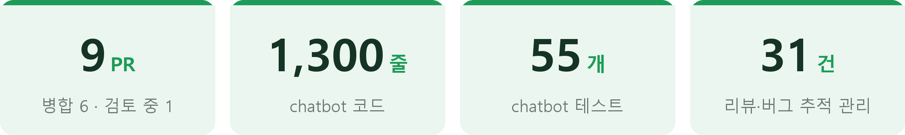
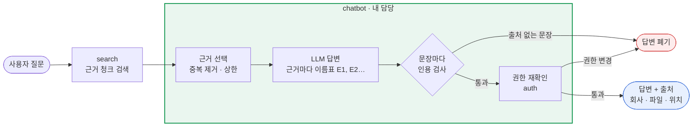
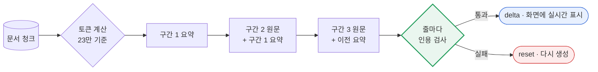
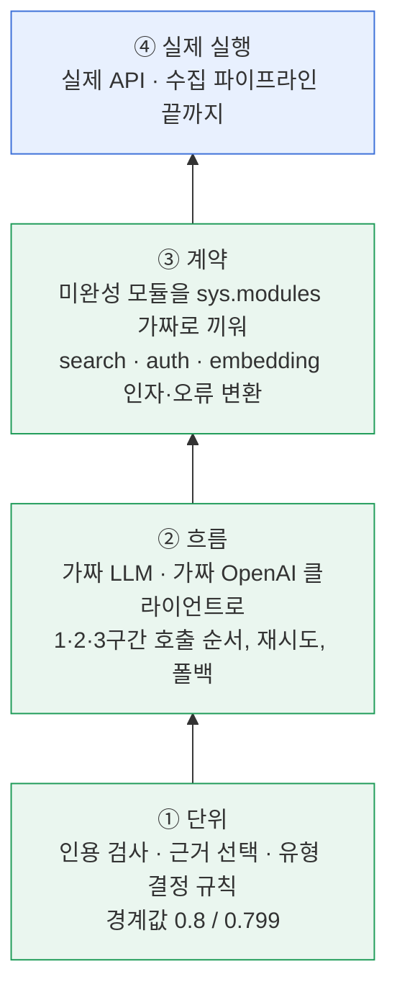
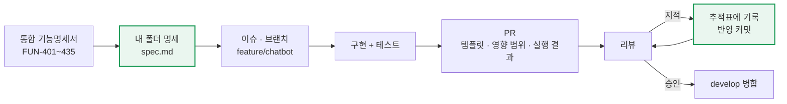

<div align="center">

# 근거 기반 AI 답변·요약 엔진

**현답 프로젝트 · `chatbot` 파트 · 소용우**

LLM이 지어낸 답은 화면에 내보내지 않는다 — 회사 문서 근거로만 답하고, 모든 문장에 출처를 붙입니다.

<br>


<br>

[한눈에 보기](#overview) · [구조](#arch) · [핵심 기능](#features) · [성과](#results) · [테스트](#test) · [작업 방식](#workflow) · [타임라인](#timeline) · [트러블슈팅](#trouble) · [배운 점](#learned)

</div>

<br>

<a id="overview"></a>




<br>

| | |
|---|---|
| **프로젝트** | 다중 기업 문서 검색 플랫폼 **현답** — 회사별 문서를 올리고, 검색하고, AI에게 질문·요약을 요청 |
| **과정** | 현대 부트캠프 AI서비스개발과정 3팀 · 2026.10.08 ~ 2026.11 |
| **팀** | 7명 · 폴더 단위 담당제 · 모든 변경은 PR 리뷰 승인 후 병합 |
| **내 역할** | [`hyundap/chatbot/`](hyundap/chatbot) **전담** — 질문 답변, 긴 문서 요약·스트리밍, 업로드 문서 자동 분류 |
| **기술** | Python 3.11 · OpenAI API (gpt-5 / gpt-6-luna / Decisions API) · LangChain · tiktoken · unittest |
| **원본 레포** | [paul8004-lee/Hyundap](https://github.com/paul8004-lee/Hyundap) (팀 전체 소개) |

> [!NOTE]
> 이 레포는 팀 프로젝트의 포크입니다. 이 README는 그중 **제가 설계·구현한 `chatbot` 파트**를 중심으로 정리했습니다.

<br>

<a id="arch"></a>


검색(search)이 찾아 준 문서 조각만 근거로 LLM이 답하게 하고, 화면에 보내기 전에 **인용 검사**와 **권한 재확인** 두 관문을 거칩니다.



| 공개 함수 | 하는 일 |
|---|---|
| `ask(question, filters, user)` | 근거 검색 → 답변 생성 → 인용 검사 → 권한 재확인 → 답변·출처 반환 |
| `summarize_document(document_id, user)` | 긴 문서를 토큰 기준 1~3구간으로 나눠 직렬 요약 |
| `summarize_document_stream(document_id, user)` | 같은 요약을 `status` · `delta` · `reset` · `done` 이벤트로 실시간 전송 |
| `classify_common_document(doc)` | 업로드 문서의 유형과 회사 일치 여부를 자동 분류 |
| `decide_doc_type(classification, current)` | 확신도 기준으로 최종 문서 유형 결정 |
| `to_feedback(error)` | 내부 오류를 숨기고 화면용 안내 문구로 변환 |

<details>
<summary><b>화면에서 보이는 위치</b> (UI는 팀원 담당 · 예시 데이터)</summary>
<br>

<br>
상단 <b>AI 답변</b>, 오른쪽 <b>AI 파일 요약</b>, 아래 <b>답변 근거 [1]~[3]</b>이 chatbot이 돌려주는 결과입니다.
</details>

<br>

<a id="features"></a>


### ① 근거 기반 답변 — 지어낸 답은 화면에 나가지 않게

| 문제 | 해결 |
|---|---|
| LLM이 문서에 없는 내용을 그럴듯하게 지어냄 | 근거마다 `[E1]` 이름표를 붙이고 **모든 문장 끝에 이름표**를 요구. 출처 없는 문장이나 준 적 없는 이름표가 있으면 **답변 전체 폐기** |
| 근거가 없는데도 일단 답하려 함 | 근거가 0개면 **LLM을 부르지 않고** "제공된 문서에서 확인할 수 없습니다" |
| 답변 생성 중 권한이 바뀔 수 있음 | 반환 직전 인용한 문서·버전 접근을 auth에 **다시 확인**, 실패하면 답변 폐기 |
| 내부 오류 원문이 화면에 노출될 위험 | 다른 파트 오류를 chatbot 오류 코드로 변환(`map_dependency_error`), 화면엔 안내 문구만(`to_feedback`) |

```text
[LLM 원본]  신입 교육은 11월 3일에 시작합니다 [E3].
[화면 출력]  신입 교육은 11월 3일에 시작합니다 [1].
            [1] A사 · 교육안내.pdf · p.2 — "신입 교육은 11월 3일(월)부터…"
```

### ② 긴 문서 요약 + 실시간 스트리밍 · [#214](https://github.com/paul8004-lee/Hyundap/pull/214)

| 문제 | 해결 |
|---|---|
| 8청크씩 부분 요약 → 병합 방식이라 LLM **최대 9회** 호출 | tiktoken으로 토큰을 세서 한 호출에 **23만 토큰**, 넘치면 1~3구간 **직렬 요약** (앞 요약 + 다음 구간 원문) |
| 64청크 상한 때문에 큰 문서 뒤쪽이 잘림 | 최대 3회로 **약 66만 토큰**까지 처리, 넘치면 제외 범위를 명시(`is_full=False`) |
| 결과가 나올 때까지 화면이 빈 상태 | 줄이 완성될 때마다 인용 검사, **통과한 줄만** `delta`로 실시간 전송 |
| 요약 1건이 분당 토큰 한도를 크게 소모 → 질문 답변까지 실패 | 서버 전체 **동시 요약 1개** 제한, 대기 1초 후 안내 |
| 스트리밍 거절 · 입력 길이 초과 | 일괄 응답으로 폴백, 구간을 다시 나눠 1회 재시도 |



UI 담당과는 [이벤트 규약 문서](hyundap/chatbot/docs/summary_stream.md)로 연결했습니다. 기존 `summarize_document()`의 형식은 그대로 둬서 **UI 코드는 수정 없이** 동작합니다.

```text
작은 문서   status(final) → delta × n → done
큰 문서     status(step 1/3) → status(step 2/3) → status(final 3/3) → delta × n → done
인용 실패   status → delta × 2 → reset('근거 확인에 실패해 다시 생성합니다.') → delta × n → done
```

### ③ 업로드 문서 자동 분류 · [#241](https://github.com/paul8004-lee/Hyundap/pull/241) [#267](https://github.com/paul8004-lee/Hyundap/pull/267)

| 문제 | 해결 |
|---|---|
| 업로드마다 사람이 유형을 고르고 회사를 확인 | OpenAI **Decisions API에 질문 3개를 1회**에 — 유형(4종)·회사명 존재·업로드 회사 일치 |
| 긴 문서는 비용·시간이 커짐 | 입력을 파일명 + 앞쪽 본문 **6,000자로 고정** |
| 본문에 회사명이 없어도 업로드 회사명에 끌려가 "일치" | `company_named` 확률 0.5 이상일 때만 일치 판단 |
| 분류 실패가 업로드를 멈추게 할 위험 | 예외 대신 `status='failed'` 반환 → **업로드는 계속** |
| 낮은 확신도의 AI 판단이 그대로 저장됨 | `decide_doc_type`: **확신도 0.8 이상만 적용**, 아니면 현재 유형 유지 + 사유 코드(`LOW_CONFIDENCE` · `CLASSIFY_FAILED`) |

실제 API 검증: 업로드 문서 1건 + 합성 문서 16건 × 2 → **유형 16/16 · 회사 일치 13/13 · 불일치 13/13 · 회사명 없음 6/6**

<br>

<a id="results"></a>


### 요약 개편 전후 · [#214](https://github.com/paul8004-lee/Hyundap/pull/214)

| 항목 | 이전 | 이후 |
|---|:---:|:---:|
| 문서당 LLM 호출 | 최대 9회 | **최대 3회** |
| 처리 가능한 분량 | 64청크 (뒤쪽 잘림) | **약 66만 토큰** |
| 글 위주 150~250쪽 문서 | 여러 번 호출 | **1회** |
| 화면 표시 | 완료 후 한 번에 | **검증된 줄부터 실시간** |

### 모델 선택 실측 · [#276](https://github.com/paul8004-lee/Hyundap/pull/276) (검토 중)

감이 아니라 측정으로 고르기 위해, 운영 프롬프트·인용 검사·제한 시간은 그대로 두고 **모델만 바꿔** 비교했습니다.

<table>
<tr><th>질문 답변 (모델당 132건)</th><th>요약 (모델당 18건)</th></tr>
<tr><td>

| 항목 | **luna** | gpt-4o | gpt-5 |
|---|:---:|:---:|:---:|
| 정답 | **132/132** | 131 | 130 |
| 근거 없음 거부 | **9/9** | 9/9 | 7/9 |
| 지연 중앙값 | 1.5초 | 0.96초 | 5.7초 |
| 1,000건 비용 | **$0.15** | $3.34 | $5.78 |

</td><td>

| 항목 | **luna** | gpt-5 | gpt-4o |
|---|:---:|:---:|:---:|
| 핵심 사실 | **212/213** | 211 | 101 |
| 인용 통과 | **18/18** | 18/18 | 12/18 |
| 첫 글자 | **2.8초** | 10.7초 | 0.9초 |
| 1,000건 비용 | **$0.68** | $16.80 | $8.10 |

</td></tr>
</table>

> [!TIP]
> 측정하다가 프롬프트("**항목**마다 이름표")와 인용 검사("**문장**마다 이름표")의 기준이 달라 정상 요약이 통째로 탈락하던 **잠재 버그**를 찾았습니다. 프롬프트를 고친 뒤 인용 검사 통과율이 **6/18 → 18/18**이 됐습니다.

<br>

<a id="test"></a>


LLM과 다른 파트에 의존하는 코드라, **바깥은 가짜로 바꾸고 내 로직만 결정적으로 검증**하는 것을 기본으로 했습니다.



| 테스트 파일 | 수 | 확인하는 것 |
|---|:---:|---|
| [`test_chatbot.py`](hyundap/tests/test_chatbot.py) | 12 | 문장별 인용 검사 (목록·날짜·제목 줄·다음 줄 이름표·없는 이름표), 필터 형식 |
| [`test_chatbot_summary.py`](hyundap/tests/test_chatbot_summary.py) | 22 | 1·2·3구간 호출 수와 순서, 3구간 초과 제외, **무인용 줄이 화면에 안 나감**, 재시도 상한, 스트리밍 거절 폴백, 길이 초과 재계획, 동시 요약 자리 반환, 스레드 풀 고갈 방지 |
| [`test_chatbot_doc_classifier.py`](hyundap/tests/test_chatbot_doc_classifier.py) | 21 | 입력 6,000자, 회사 일치 기준, 거부 응답, **API 실패 시 키 노출 없음**, 기준 경계 0.8 / 0.799, 새 버전 유형 유지, 업로드 경로 연결 |

**이렇게 검증했습니다**

- **다른 파트가 완성되기 전부터 테스트** — search·auth·embedding이 아직 없을 때 `sys.modules`에 가짜 모듈을 끼우고, LLM은 `FakeListChatModel`로 바꿔 **58개 검사**를 먼저 통과시킨 뒤 PR을 올렸습니다 ([#134](https://github.com/paul8004-lee/Hyundap/pull/134)).
- **PR마다 저장소 전체 테스트 실행** — 요약 개편 때 389개 → 406개, 분류 기능 병합 때 **607개 전체 통과** (skip 85개는 격리 MySQL이 필요한 DB 테스트).
- **가짜로 확인한 부분은 실제로도 확인** — 수집 테스트가 `decide_doc_type`을 가짜로 끼우고 있어서, 실제 함수로 수집 파이프라인을 끝까지 돌려 5가지 경우의 저장 결과를 표로 확인했습니다 ([#267](https://github.com/paul8004-lee/Hyundap/pull/267)).
- **실제 모델로 반복 측정** — 같은 질문을 3회씩 돌려 우연한 통과를 걸러냈습니다 (44문항 × 3회, 요약 6건 × 3회).

<details>
<summary><b>테스트 예시 — 근거 없는 줄은 스트리밍에서도 절대 나가지 않는다</b></summary>

가짜 LLM이 1차 응답에 이름표 없는 줄을 섞으면, 그 줄은 화면에 나가지 않고 `reset` 후 다시 생성돼야 합니다.

```python
def test_uncited_line_is_never_shown(self):
    events, _, _ = self.run_summary(2, ['- 근거 있음 [E1].\n- 근거 없는 문장입니다.\n- 다음 [E2].', '- 다시 [E1].'])
    shown = [e['text'] for e in events if e['type'] == 'delta']
    self.assertNotIn('근거 없는', ''.join(shown))
    self.assertIn({'type': 'reset', 'reason': '근거 확인에 실패해 다시 생성합니다.'}, events)
    self.assertEqual(events[-1]['response'].summary, '- 다시 [1].')
```

기준 경계와, 기준을 상수 하나로 바꿀 수 있는지를 함께 확인합니다.

```python
def test_threshold_boundary(self):
    decide = doc_classifier.decide_doc_type
    self.assertEqual(decide(self.classified(confidence=0.8), 'other'), ('policy', False, None))
    self.assertEqual(decide(self.classified(confidence=0.799), 'other'), ('other', True, 'LOW_CONFIDENCE'))
    # 기준은 상수 하나로 바뀐다
    with patch.object(doc_classifier, 'CLASSIFY_APPLY_MIN_CONFIDENCE', 0.95):
        self.assertEqual(decide(self.classified(confidence=0.93), 'other'), ('other', True, 'LOW_CONFIDENCE'))
```

</details>

<br>

<a id="workflow"></a>




| 원칙 | 실제로 한 것 |
|---|---|
| **명세 먼저** | 팀 통합 명세(FUN-401~)를 기준으로 [`spec.md`](hyundap/chatbot/docs/spec.md)에 흐름·함수 입출력·오류 코드·미정 사항을 먼저 쓰고 구현. 명세 밖 함수를 추가하면 9절에 이유와 함께 기록 |
| **담당 경계 지키기** | `chatbot/` 밖은 직접 고치지 않고 이슈로 요청 ([#230](https://github.com/paul8004-lee/Hyundap/issues/230) [#238](https://github.com/paul8004-lee/Hyundap/issues/238)). 다른 폴더를 크게 바꾸던 PR [#223](https://github.com/paul8004-lee/Hyundap/pull/223)은 **직접 닫고** 내 폴더 안으로 다시 설계 |
| **인터페이스 고정** | 공개 함수의 이름·인자·반환 형식을 유지해서 리팩터링·요약 개편 후에도 **다른 파트 수정 0줄** |
| **리뷰를 추적표로 관리** | 리뷰·QA 지적 31건을 명세 10절 표에 번호·처리 결과로 기록 (30건 해결, 1건은 부작용 때문에 이유를 적고 보류) |
| **PR은 읽는 사람 기준** | "한눈에 보기 → 원인 → 수정 → 영향 범위 → 테스트 결과" 순서, 리뷰어별 확인 요청을 따로 적음 |
| **충돌은 비교표로 조율** | 같은 버그를 고치는 다른 PR과 겹쳤을 때 두 방식을 표로 비교해, 명세를 바꾸지 않는 쪽을 제안 ([#194](https://github.com/paul8004-lee/Hyundap/pull/194)) |
| **AI 도구 활용** | Claude Code로 코드·명세 초안과 검사를 하고, **설계 결정과 최종 검토는 직접** 함 (PR마다 명시) |

<details>
<summary><b>리뷰 추적표 일부</b> (<a href="hyundap/chatbot/docs/spec.md">spec.md</a> 10절)</summary>
<br>

| # | 지적 | 처리 |
|---|---|---|
| 2 | 인용 없는 문장이 섞여도 통과 | 문장마다 이름표 확인 |
| 11 | 재검증이 `False` 반환을 기다림 — DB 계약은 예외만 씀 | 예외만 처리, `STATE_CHANGED` 변환 |
| 14 | 요약 사전 확인이 버전 ID 없이 실행 | 청크를 받은 뒤 실제 버전으로 확인, 확인 전 LLM 미호출 |
| 22 | search 미구현 ImportError가 화면에 일반 오류로 노출 | import를 변환 범위 안으로, `RETRIEVAL_FAILED` |
| 26 | 숫자로 끝난 무인용 문장이 다음 문장과 묶여 통과 | **보류** — 고치면 날짜 표기가 거부됨. 한국어 답변에선 드물어 이유를 기록 |
| 27 | 세션 만료가 재로그인 안내로 가지 않음 | `SESSION_EXPIRED` 코드 추가 |

</details>

<br>

<a id="timeline"></a>


| 날짜 | 작업 | PR |
|---|---|---|
| **10/26** | 근거 기반 답변·요약 첫 구현, 명세 작성 (+928줄) | [#134](https://github.com/paul8004-lee/Hyundap/pull/134) |
| **10/26** | 긴 함수 7개 → 작은 함수 21개 리팩터링, 오류 4건 수정, 리뷰 3건 반영 | [#144](https://github.com/paul8004-lee/Hyundap/pull/144) |
| **10/27** | "선택 문서" 범위에서 정답 근거가 잘리던 버그, 제목 줄 거부 버그 수정 | [#194](https://github.com/paul8004-lee/Hyundap/pull/194) |
| **10/28** | 요약 전면 개편: 토큰 기준 직렬 요약 + 줄 단위 스트리밍 (+946줄) | [#214](https://github.com/paul8004-lee/Hyundap/pull/214) |
| **10/28** | 임베딩 단계 분류 시도 → 담당 경계 문제로 직접 닫음 | [#223](https://github.com/paul8004-lee/Hyundap/pull/223) |
| **10/29** | 업로드 문서 자동 분류 (Decisions API), 리뷰 5회 거쳐 병합 | [#241](https://github.com/paul8004-lee/Hyundap/pull/241) |
| **10/29** | 최종 유형 결정 `decide_doc_type`, 쓰지 않는 코드 삭제 | [#267](https://github.com/paul8004-lee/Hyundap/pull/267) |
| **10/30** | 모델 실측 비교 → gpt-6-luna 전환, 인용·근거 선택 보완 | [#276](https://github.com/paul8004-lee/Hyundap/pull/276) |

<br>

<a id="trouble"></a>


<details open>
<summary><b>"선택 문서"로 좁히면 답이 있는데도 "확인할 수 없습니다"</b> · <a href="https://github.com/paul8004-lee/Hyundap/pull/194">#194</a></summary>
<br>

**원인** — 문서당 근거 4개 상한이 항상 적용돼, 한 문서만 대상일 때 8자리 중 4자리만 쓰였습니다.

```text
search가 준 근거   섹션 6, 5, 4, 2, 7(정답), 1, 3, 8(정답)
이전에 넘긴 근거   섹션 6, 5, 4, 2                     ← 정답 없음
```

**해결** — 문서당 상한을 `max(4, 8 ÷ 근거에 나온 문서 수)`로 정했습니다. 함수 인자를 바꾸지 않아 명세·다른 파트 수정이 필요 없고, "전체 검색인데 결과가 우연히 한 문서뿐인 경우"까지 함께 해결됩니다.

</details>

<details>
<summary><b>마크다운 제목 줄 때문에 정상 답변이 통째로 거부됨</b> · <a href="https://github.com/paul8004-lee/Hyundap/pull/194">#194</a> <a href="https://github.com/paul8004-lee/Hyundap/pull/214">#214</a></summary>
<br>

**원인** — 프롬프트가 "회사별로 나눠 답하라"고 하니 LLM이 `**현대경제연구원**`, `### 개요` 같은 제목을 썼는데, 인용 검사는 콜론으로 끝나는 제목만 허용했습니다. '요'로 끝나면 문장으로 보는 규칙 때문에 `### 개요`도 걸렸습니다.

**해결** — 짧은 제목 줄은 통과시키되, 문장 끝말(`니다` · `세요` · `해요`)로 끝나면 계속 검사합니다. `**…입니다**`처럼 강조로 감싼 무인용 문장은 여전히 막힙니다.

</details>

<details>
<summary><b>요약 1건이 질문 답변까지 실패시킴</b> · <a href="https://github.com/paul8004-lee/Hyundap/pull/214">#214</a></summary>
<br>

**원인** — 23만 토큰짜리 요약 하나가 분당 토큰 한도를 크게 써서, 동시에 돌면 다른 사용자의 질문 답변까지 한도 초과로 실패할 수 있었습니다.

**해결** — 서버 전체에서 동시 요약을 1개로 제한하고, 자리가 없으면 1초만 기다린 뒤 "다른 요약이 진행 중입니다"로 안내합니다. 기다리는 요청이 스레드 풀을 막지 않는지도 테스트로 확인했습니다.

</details>

<details>
<summary><b>점수 낮은 다른 문서 하나 때문에 주 문서의 근거가 잘림</b> · <a href="https://github.com/paul8004-lee/Hyundap/pull/276">#276</a></summary>
<br>

**원인** — 0.302점짜리 다른 문서가 하나 섞이면 "여러 문서"로 판정돼 문서당 상한이 4개로 줄었고, "점검 절차를 순서대로" 질문에서 4단계가 빠졌습니다.

**해결** — 상한을 적용한 뒤 자리가 남으면 잘린 근거로 점수순으로 채웁니다. 실제 문서 질문 **11/12 → 36/36**.

</details>

<details>
<summary><b>분류 기능을 어디에 둘 것인가</b> · <a href="https://github.com/paul8004-lee/Hyundap/pull/223">#223</a> → <a href="https://github.com/paul8004-lee/Hyundap/pull/241">#241</a></summary>
<br>

**상황** — 처음엔 임베딩 단계에 분류를 넣었지만(#223), 다른 담당자의 폴더를 크게 바꾸는 구조였습니다.

**판단** — PR을 직접 닫고, 분류 로직은 `chatbot/doc_classifier.py`에 두고 수집 단계에서 호출만 하도록 다시 설계했습니다. 다른 파트 변경은 **+64 / −3줄**로 줄었고, 해당 담당자 확인을 이슈로 따로 요청했습니다.

</details>

<br>

<a id="learned"></a>


| | |
|---|---|
| 🔍 **LLM 출력은 검사한다** | 프롬프트로 부탁하는 것만으로는 부족했습니다. 코드로 검사해 통과한 것만 내보내야 신뢰할 수 있었습니다. |
| 📏 **프롬프트와 검사는 같은 기준** | "항목"과 "문장"의 차이 하나로 정상 답변이 통째로 탈락했습니다. |
| 📊 **모델은 실측으로 고른다** | 같은 조건에서 정답률·지연·비용을 재 보니, 최신·대형 모델이 항상 답은 아니었습니다. |
| 🔌 **인터페이스를 고정하면 내부는 자유롭다** | 요약을 전면 개편해도 다른 파트는 한 줄도 고치지 않았습니다. |
| 🧱 **담당 경계도 설계다** | 다른 폴더를 크게 바꾸는 PR을 닫고 내 쪽으로 다시 설계한 것이 결과적으로 리뷰와 병합을 빠르게 했습니다. |

<br>


```text
hyundap/chatbot/
├── ask.py             질문 1개 처리 흐름, 근거 선택
├── citations.py       근거 이름표, 문장·줄 단위 인용 검사, 출처 생성
├── summary.py         구간 계획, 직렬 요약, 스트리밍, 동시 실행 제한
├── doc_classifier.py  문서 자동 분류, 최종 유형 결정
├── prompts.py         답변·요약 프롬프트, OpenAI 연결
├── models.py          결과·오류 클래스, 오류 변환
├── constants.py       기본값, 오류 안내 문구
└── docs/
    ├── spec.md            상세 명세 (흐름, 함수 입출력, 오류 코드, 리뷰 추적표)
    └── summary_stream.md  UI 연결용 스트리밍 이벤트 규약
```

<br>

<div align="center">

**[원본 레포](https://github.com/paul8004-lee/Hyundap)** · **[내 PR 전체](https://github.com/paul8004-lee/Hyundap/pulls?q=is%3Apr+author%3Anasaro-pro)** · **[GitHub @nasaro-pro](https://github.com/nasaro-pro)**

</div>
